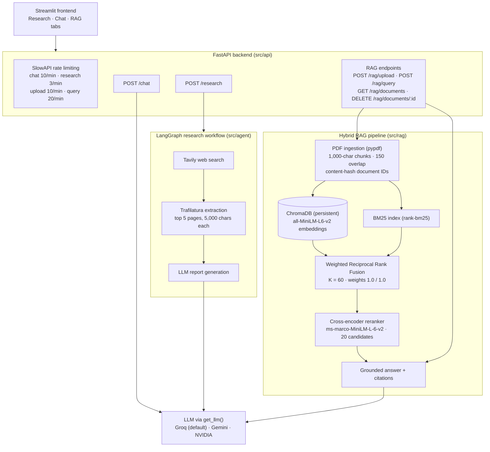
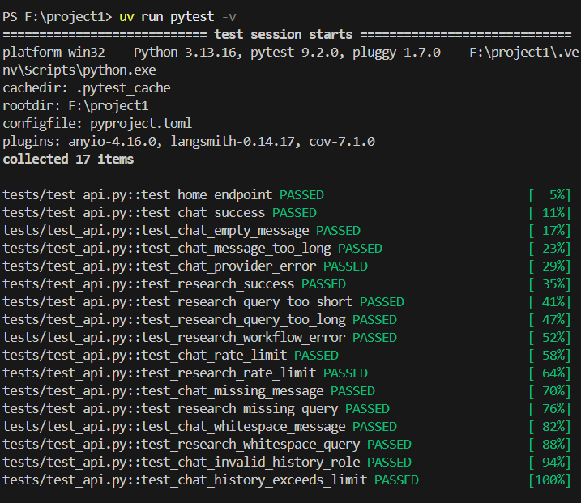
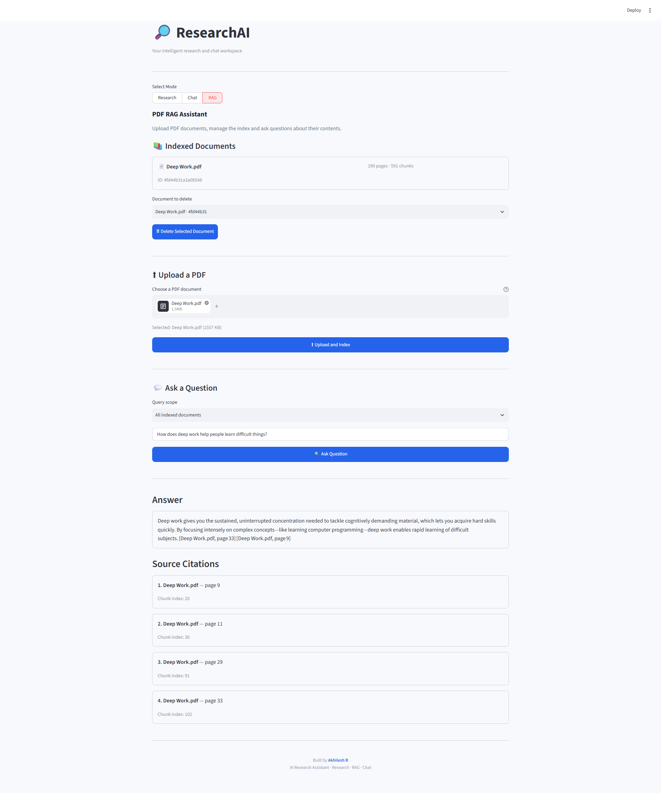
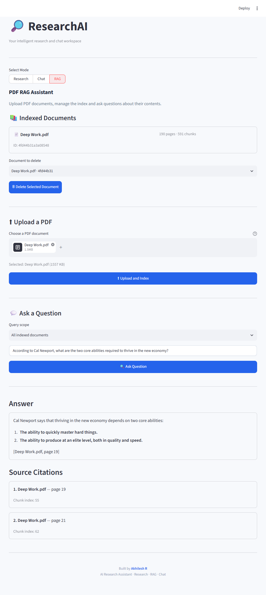
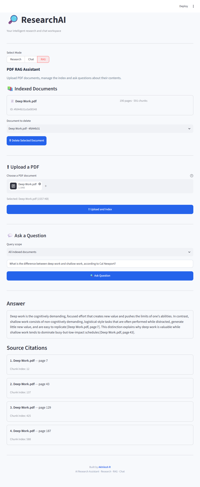

# ResearchAI

**An AI-powered research assistant and document question-answering application, built with Python 3.13, FastAPI, LangGraph, Streamlit and a hybrid retrieval pipeline.**

> **At a glance.** ResearchAI unifies web research and document-grounded question answering behind one FastAPI + Streamlit stack. The retrieval layer combines dense (Sentence Transformers + ChromaDB) and sparse (BM25) search with weighted Reciprocal Rank Fusion, then reranks candidates with a cross-encoder before answering. A reproducible 17-question evaluation is committed alongside the code — Hybrid + Cross-Encoder reaches **nDCG@5 = 0.807** and **Recall@5 = 0.814** at approximately **1.04 s mean retrieval latency**. Full results: [Baseline results](#baseline-results).

ResearchAI combines two capabilities in one application:

1. **Research Assistant** — runs a LangGraph workflow that searches the web with Tavily, extracts page content with Trafilatura, and generates a structured research report with an LLM.
2. **Hybrid RAG** — ingests PDFs into a persistent vector store, retrieves with both dense embeddings and BM25, fuses the two rankings with weighted Reciprocal Rank Fusion (RRF), reranks candidates with a cross-encoder, and returns grounded answers with source citations (filename, page, chunk index).

The retrieval pipeline is backed by an **evaluation framework** (17 manually graded questions, four retrieval methods, nDCG/MRR/precision/recall metrics and reproducibility metadata) — see [Retrieval evaluation](#retrieval-evaluation).

## Features

| Area | Implemented capabilities |
|---|---|
| Research | Tavily web search, Trafilatura content extraction (top 5 pages, up to 5,000 characters each), LangGraph report generation, source URLs |
| Chat | Groq-powered conversation with bounded history replay (maximum 6 history items), 500-token reply cap, clear-chat in the UI |
| Document intelligence | PDF ingestion with pypdf, overlapping chunks (1,000 characters / 150 overlap) with page and chunk metadata, content-hash document IDs, duplicate-safe re-ingestion, document listing and deletion |
| Retrieval | Sentence Transformers embeddings (`all-MiniLM-L6-v2`) in ChromaDB, BM25 (`rank-bm25`), weighted RRF fusion (K=60, weights 1.0/1.0), cross-encoder reranking (`ms-marco-MiniLM-L-6-v2`) over 20 candidates |
| Answering | Grounded answers with source citations, deduplicated citations, explicit no-answer response |
| API | FastAPI with request validation, typed response models, per-endpoint rate limiting (SlowAPI), structured error handling |
| Evaluation | 17-question graded dataset, four retrieval methods, Precision@5 / Recall@5 / MRR / nDCG@5 / latency, JSON and Markdown reports, reproducibility metadata |
| Quality | 183 automated tests covering the API, RAG pipeline and evaluation, with coverage reporting through pytest-cov |

## Architecture



### Retrieval flow

1. **Ingestion:** Extract text from uploaded PDFs and split it into overlapping chunks. Store document and chunk metadata.
2. **Dense retrieval:** Generate embeddings using Sentence Transformers and search the persistent ChromaDB collection.
3. **Sparse retrieval:** Retrieve keyword-relevant chunks using BM25.
4. **Fusion:** Combine the two ranked result lists using weighted Reciprocal Rank Fusion.
5. **Reranking:** Score the fused candidates with a cross-encoder and select the highest-ranked context.
6. **Answer generation:** Pass the retrieved context to the LLM and return an answer with source citations.

## Tech stack

| Component | Technology |
|---|---|
| Language | Python 3.13 |
| Backend | FastAPI, Pydantic |
| Frontend | Streamlit |
| Agent workflow | LangGraph |
| LLM providers | Groq, Gemini, NVIDIA |
| Web search | Tavily |
| Web extraction | Trafilatura |
| PDF processing | pypdf |
| Text splitting | LangChain text splitters |
| Embeddings | Sentence Transformers |
| Vector database | ChromaDB |
| Keyword retrieval | BM25 (`rank-bm25`) |
| Reranking | Cross-Encoder (`ms-marco-MiniLM-L-6-v2`) |
| Rate limiting | SlowAPI |
| Testing | Pytest, pytest-cov |
| Package management | uv |

## Project structure

```text
researchAi/
│
├── frontend/
│   └── app.py
│
├── src/
│   ├── main.py
│   │
│   ├── agent/
│   │   └── graph.py
│   │
│   ├── api/
│   │   ├── api.py
│   │   ├── rag_routes.py
│   │   └── rate_limit.py
│   │
│   ├── config/
│   │   └── settings.py
│   │
│   ├── llm/
│   │   └── providers.py
│   │
│   ├── tools/
│   │   ├── search.py
│   │   └── scraper.py
│   │
│   └── rag/
│       ├── evaluation/
│       │   ├── dataset.py
│       │   ├── evaluate.py
│       │   ├── metrics.py
│       │   └── report.py
│       ├── tests/
│       ├── hybrid_retriever.py
│       └── ...
│
├── tests/
│   ├── test_api.py
│   └── test_rag_api.py
│
├── scripts/
│   ├── check_eval.py
│   └── debug_retrieval.py
│
├── reports/
│   └── rag_evaluation/
│
├── docs/
│   └── assets/
│
├── .env.example
├── .python-version
├── pyproject.toml
├── uv.lock
└── README.md
```

## Getting started

### Prerequisites

- Python 3.13
- [uv](https://docs.astral.sh/uv/)
- Git
- API keys for the services you intend to use

### 1. Clone the repository

```bash
git clone https://github.com/akhileshr24/researchAi.git
cd researchAi
```

### 2. Install dependencies

```bash
uv sync
```

### 3. Configure environment variables

Create a `.env` file from the example:

**PowerShell**

```powershell
Copy-Item .env.example .env
```

Add the API keys for the providers and services you want to use.

| Variable | Purpose |
|---|---|
| `GROQ_API_KEY` | **Required** for chat, research reports and RAG answers (default provider) |
| `GROQ_MODEL` | Groq model ID (defaults to `openai/gpt-oss-120b`) |
| `TAVILY_API_KEY` | **Required for research mode** (Tavily web search) |
| `PRIMARY_LLM` | **Declared in the template but not read by the current code** — provider selection happens via the `get_llm(provider=...)` argument, which defaults to `"groq"` |
| `GEMINI_API_KEY` | Optional Google provider (`get_llm("gemini")`) |
| `GEMINI_MODEL` | Gemini model ID (defaults to `gemini-2.5-flash`) |
| `NVIDIA_API_KEY` | Optional NVIDIA provider (`get_llm("nvidia")`) |
| `NVIDIA_BASE_URL` | NVIDIA OpenAI-compatible endpoint (defaults to `https://integrate.api.nvidia.com/v1`) |
| `NVIDIA_MODEL` | NVIDIA model selection |
| `API_BASE_URL` | FastAPI base URL for the frontend (defaults to `http://127.0.0.1:8000`) |
| `LANGSMITH_API_KEY` | Optional LangSmith integration |
| `LANGSMITH_TRACING` | Enable/disable LangSmith tracing |
| `LANGSMITH_PROJECT` | LangSmith project name |

Keep `.env` private. Never commit API keys or other secrets.

### 4. Start the FastAPI backend

```bash
uv run uvicorn src.main:app --reload
```

The API will be available at:

```text
http://127.0.0.1:8000
```

Interactive API documentation:

```text
http://127.0.0.1:8000/docs
```

### 5. Start the Streamlit frontend

Open another terminal:

```bash
uv run streamlit run frontend/app.py
```

### 6. Run the tests

```bash
# Full test suite (183 tests)
uv run pytest

# RAG tests only
uv run pytest src/rag/tests

# Full suite with coverage
uv run pytest --cov=src --cov-report=term-missing
```

## API overview

The FastAPI backend exposes endpoints for research, chat and document question answering.

| Method | Endpoint | Purpose |
|---|---|---|
| POST | `/chat` | Send a chat message |
| POST | `/research` | Generate a web research report |
| POST | `/rag/upload` | Upload and ingest a PDF |
| POST | `/rag/query` | Ask a question about ingested documents |
| GET | `/rag/documents` | List ingested documents |
| DELETE | `/rag/documents/{document_id}` | Delete an ingested document |

Use `/docs` for the interactive API documentation and the exact request and response schemas.

### Request constraints

| Input | Constraint |
|---|---|
| Chat message | 1–1,000 characters |
| Chat history | Maximum 6 history items |
| Research query | 3–500 characters |
| RAG question | 1–1,000 characters |
| Document ID | Maximum 64 characters |

### Rate limits

| Endpoint | Limit |
|---|---:|
| `/chat` | 10 requests/minute |
| `/research` | 3 requests/minute |
| `/rag/upload` | 10 requests/minute |
| `/rag/query` | 20 requests/minute |

### RAG answer behavior

- Answers are generated using retrieved document context.
- Source citations identify the filename, page and chunk.
- Duplicate source citations are removed.
- When relevant context cannot be found, the application returns:

```text
I couldn't find relevant information in the documents.
```

## Retrieval evaluation

ResearchAI includes a reproducible retrieval evaluation framework to compare four retrieval strategies:

1. Vector Search
2. BM25
3. Hybrid RRF
4. Hybrid RRF + Cross-Encoder

### Evaluation dataset

| Property | Value |
|---|---:|
| Evaluation questions | 17 |
| Manually graded relevance labels | Yes |
| Documents | 2 PDFs |
| Total indexed chunks | 604 |
| Deep Work.pdf chunks | 591 |
| Report.pdf chunks | 13 |
| Evaluation top-k | 5 |
| Candidate limit | 20 |
| Production top-k | 4 |

The relevance labels were manually reviewed against the stored chunk text. The evaluation dataset is small and represents the current test corpus, not a universal benchmark.

### Baseline results

<small>Baseline generated on 12 November 2026. Commit: `c80a1cc1ba408f8df0141b0d5542987bff75ba28` (tag `p1-baseline`).</small>

| Retrieval method | Precision@5 | Recall@5 | MRR | nDCG@5 | Mean latency |
|---|---:|---:|---:|---:|---:|
| Vector Search | 0.3176 | 0.6255 | 0.8235 | 0.6405 | 86.68 ms |
| BM25 | 0.3529 | 0.6941 | 0.8137 | 0.7309 | 75.73 ms |
| Hybrid RRF | 0.3647 | 0.7059 | 0.8529 | 0.7229 | 92.02 ms |
| Hybrid + Cross-Encoder | **0.4235** | **0.8137** | **0.8824** | **0.8071** | 1,044.39 ms |

### Results interpretation

- **Vector Search** provides semantic retrieval, while BM25 captures keyword-based relevance.
- **Hybrid RRF** improves recall and MRR over the individual vector baseline, but does not outperform BM25 on every metric.
- **Hybrid + Cross-Encoder** achieves the best measured Precision@5, Recall@5, MRR and nDCG@5 in this evaluation.
- Cross-encoder reranking has a substantially higher measured mean latency. The quality improvement therefore comes with a latency trade-off.

These results are specific to the current 17-question evaluation dataset and 604-chunk corpus. They should not be interpreted as guaranteed performance on arbitrary documents or questions.

### Reproduce the evaluation

Run the baseline evaluation:

```bash
uv run python -m src.rag.evaluation.evaluate
```

Validate the generated evaluation reports:

```bash
uv run python scripts/check_eval.py
```

Inspect retrieval results for a document:

```bash
uv run python scripts/debug_retrieval.py <document_id>
```

Optionally provide a question:

```bash
uv run python scripts/debug_retrieval.py <document_id> --question "What is deep work?"
```

### RRF parameter experiments

The evaluation CLI supports changing the RRF configuration and writing reports to a separate output directory:

```bash
uv run python -m src.rag.evaluation.evaluate --out reports/rag_evaluation/experiment --rrf-k 80 --vector-weight 1.0 --bm25-weight 1.0
```

Available parameters:

| Parameter | Description |
|---|---|
| `--rrf-k` | RRF rank constant |
| `--vector-weight` | Dense retrieval contribution |
| `--bm25-weight` | BM25 retrieval contribution |
| `--out` | Separate output directory for experiment reports |

The default configuration is **K = 60**, with both retrieval weights set to **1.0**.

Evaluation reports are stored under:

```text
reports/rag_evaluation/
```

The reports include retrieval metrics and reproducibility information such as the Git revision and evaluation configuration.

## Application screenshots

### Research mode


*Application landing page; the default tab on startup is Research.*


*Generated research report with source URLs.*

### Chat mode


*Conversational assistant with bounded history replay.*



*Additional conversation example.*

### RAG mode



*The RAG tab with "Deep Work.pdf" indexed (190 pages · 591 chunks); the question "How does deep work help people learn difficult things?" is answered with four source citations.*



*A question about the two core abilities needed to thrive in the new economy, answered as a numbered list with citations to pages 19 and 21.*



*A question contrasting deep work and shallow work; the answer cites pages 7, 43, 129 and 187.*

A sample generated research report is available at [docs/assets/Report.pdf](docs/assets/Report.pdf).

## Current limitations

- Retrieval evaluation uses a relatively small dataset of 17 manually graded questions.
- Evaluation results may change with different PDFs, question distributions and relevance labels.
- Cross-encoder reranking increases retrieval latency considerably compared with the other retrieval methods.
- Answer quality depends on the retrieved context and the selected LLM provider.
- `PRIMARY_LLM` is declared in `.env.example` but is not read by the current code; provider selection is a function argument in `get_llm(provider=...)`.
- The application currently focuses on PDF-based document ingestion.
- No Docker, cloud-deployment or CI configuration is included.

## Future improvements

- Wire `PRIMARY_LLM` into `get_llm` so the provider is configurable without code changes.
- Expand the retrieval evaluation dataset with more documents and questions.
- Evaluate retrieval quality across different document types and domains.
- Improve automated evaluation of answer faithfulness and citation correctness.
- Investigate retrieval latency and optimization opportunities (batched scoring, ONNX export, or a smaller candidate pool).
- Add deployment and operational monitoring improvements.

## Author

**Akhilesh R.**

- GitHub: [@akhileshr24](https://github.com/akhileshr24)
- Project: [ResearchAI](https://github.com/akhileshr24/researchAi)

---

Built with Python, FastAPI, LangGraph, Streamlit and modern retrieval techniques.
Built with Python, FastAPI, LangGraph, Streamlit and modern retrieval techniques.
