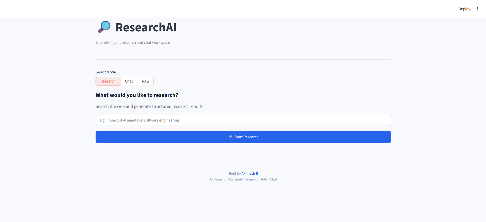
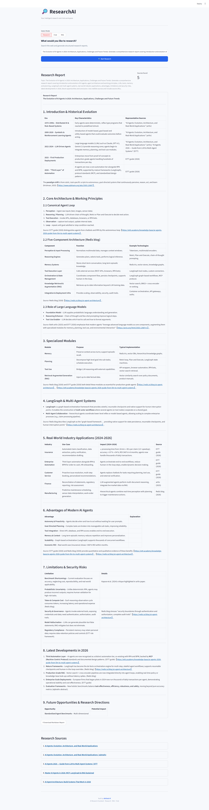
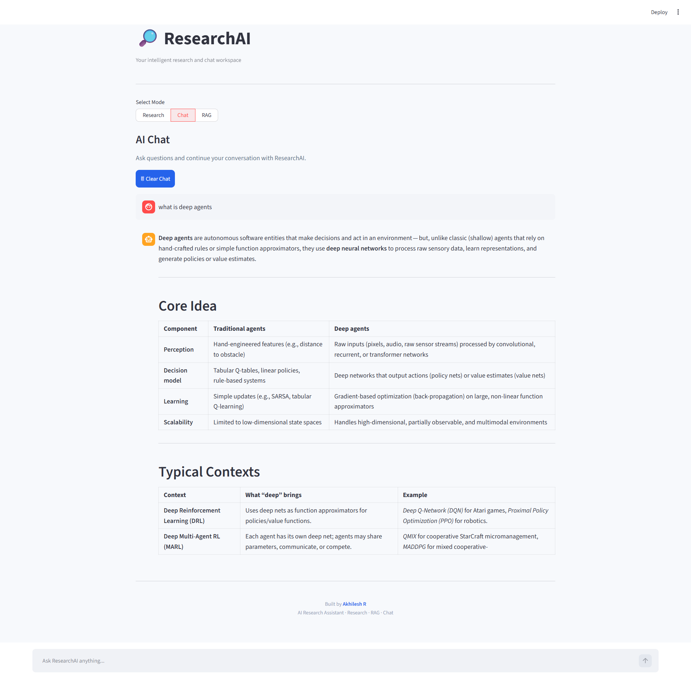

# ResearchAI

**An AI-powered research and conversational assistant built with Python, FastAPI, LangGraph, Groq, and Streamlit.**

ResearchAI helps users explore topics through web research, generate structured reports, and interact with an AI assistant through a conversational interface.

## Application Preview

### Home


### Research Mode


### Chat Mode


[View Sample Research Report (PDF)](docs/assets/Report.pdf)

## Features

### 1. Web Research
- Web search powered by Tavily.
- Webpage content extraction using Trafilatura.
- AI-generated research reports using Groq.
- Research source links.
- Markdown report download.

### 2. AI Chat
- Conversational AI powered by Groq.
- Context-aware conversations using chat history.
- Clear chat functionality.
- Request validation and error handling.

### 3. Document Intelligence (Hybrid RAG)
- PDF text extraction with `pypdf`.
- Recursive character chunking with page and document metadata.
- Hugging Face `all-MiniLM-L6-v2` embeddings.
- Persistent ChromaDB vector storage.
- Dense vector search combined with BM25 keyword search.
- Reciprocal Rank Fusion (RRF) of both ranked lists.
- Cross-encoder reranking with `ms-marco-MiniLM-L-6-v2`.
- Context-only answers with filename and page citations.
- Duplicate-safe ingestion, document listing, replacement and deletion.

## Technology Stack

| Layer | Technology |
|---|---|
| Language | Python 3.13 |
| Frontend | Streamlit |
| Backend | FastAPI |
| AI Workflow | LangGraph |
| LLM | Groq |
| Web Search | Tavily |
| Web Extraction | Trafilatura |
| PDF Parsing | pypdf |
| Embeddings | sentence-transformers `all-MiniLM-L6-v2` |
| Vector Store | ChromaDB |
| Keyword Search | rank-bm25 |
| Reranking | cross-encoder `ms-marco-MiniLM-L-6-v2` |
| Validation | Pydantic |
| Rate Limiting | SlowAPI |
| Package Management | uv |
| Testing | Pytest |

## Architecture

```text
                       USER
                         |
                         v
                    STREAMLIT UI
                         |
                         v
                     FASTAPI
                         |
                 +-------+-------+
                 |               |
                 v               v
               /chat          /research
                 |               |
                 v               v
                GROQ          LANGGRAPH
                                 |
                                 v
                           TAVILY SEARCH
                                 |
                                 v
                           TRAFILATURA
                                 |
                                 v
                         EXTRACT CONTENT
                                 |
                                 v
                               GROQ
                                 |
                                 v
                         RESEARCH REPORT
                                 |
                                 v
                           STREAMLIT UI
```

### Hybrid RAG Pipeline

```text
PDF FILES
    |
    v
pypdf TEXT EXTRACTION
    |
    v
RECURSIVE CHARACTER CHUNKING
    |
    v
all-MiniLM-L6-v2 EMBEDDINGS
    |
    v
PERSISTENT CHROMADB
    |
    +------------------------------+
    |                              |
    v                              v
VECTOR SEARCH                  BM25 KEYWORD SEARCH
    |                              |
    +--------------+---------------+
                   |
                   v
       RECIPROCAL RANK FUSION (RRF)
                   |
                   v
        CROSS-ENCODER RERANKING
                   |
                   v
     TOP-K CONTEXT --> LLM --> ANSWER + CITATIONS
```

## Project Structure

```text
ResearchAI/
│
├── docs/
│   └── assets/
│       ├── home.png
│       ├── research_output.png
│       ├── chat_output.png
│       └── Report.pdf
│
├── frontend/
│   └── app.py
│
├── src/
│   ├── agent/
│   │   └── graph.py
│   ├── api/
│   │   └── api.py
│   ├── config/
│   │   └── settings.py
│   ├── llm/
│   │   └── providers.py
│   ├── rag/
│   │   ├── loader.py
│   │   ├── chunker.py
│   │   ├── vectorstore.py
│   │   ├── bm25_retriever.py
│   │   ├── hybrid_retriever.py
│   │   ├── reranker.py
│   │   ├── ingestion.py
│   │   ├── qa.py
│   │   └── tests/
│   ├── tools/
│   │   ├── search.py
│   │   └── scraper.py
│   └── main.py
│
├── data/
│   └── chroma/        # generated, gitignored
│
├── tests/
│   └── test_api.py
│
├── .env.example
├── .gitignore
├── .python-version
├── pyproject.toml
├── uv.lock
└── README.md
```

## Getting Started

### Prerequisites

- Python 3.13
- [uv](https://docs.astral.sh/uv/)
- [Groq API Key](https://console.groq.com/)
- [Tavily API Key](https://tavily.com/)

### 1. Clone the repository

```bash
git clone https://github.com/akhileshr24/researchAi.git
cd researchAi
```

### 2. Install dependencies

```bash
uv sync
```

### 3. Configure environment variables

Create a `.env` file in the project root using `.env.example` as a reference.

```env
# Groq
GROQ_API_KEY=your_groq_api_key
GROQ_MODEL=openai/gpt-oss-120b

# Tavily
TAVILY_API_KEY=your_tavily_api_key

# LangSmith (Optional)
LANGSMITH_TRACING=false
LANGSMITH_API_KEY=
LANGSMITH_PROJECT=ResearchAI
```

To enable LangSmith tracing, configure your LangSmith API key and set:

```env
LANGSMITH_TRACING=true
LANGSMITH_API_KEY=your_langsmith_api_key
LANGSMITH_PROJECT=ResearchAI
```

LangSmith provides tracing and observability for supported LangChain and LangGraph operations.

**Important:** Never commit your `.env` file or expose API keys. Keep actual credentials private.

### 4. Start the backend

```bash
uv run uvicorn src.main:app --reload
```

Backend URL:

http://127.0.0.1:8000

Interactive API documentation:

http://127.0.0.1:8000/docs

### 5. Start the frontend

Open another terminal:

```bash
uv run streamlit run frontend/app.py
```

Application URL:

http://localhost:8501

### 6. Use the hybrid RAG pipeline

```python
from src.rag.ingestion import ingest_pdf
from src.rag.qa import ask_question
from src.rag.vectorstore import delete_document, list_documents

result = ingest_pdf("docs/assets/test.pdf")
print(result["status"], result["total_chunks"])

print(list_documents())

answer = ask_question("What is retrieval-augmented generation?")
print(answer["answer"])
print(answer["sources"])

delete_document(result["document_id"])
```

Re-ingesting the same file is skipped automatically. Pass `replace=True` to
`ingest_pdf()` to rebuild a document, or delete it by `document_id`.
The QA step uses the configured `GROQ_API_KEY`.

## API Reference

| Method | Endpoint | Description |
|---|---|---|
| GET | `/` | API health response |
| POST | `/chat` | AI conversational endpoint |
| POST | `/research` | Web research workflow |

### Chat Request

```json
{
  "message": "Explain AI agents",
  "history": []
}
```

### Research Request

```json
{
  "query": "The evolution of AI agents"
}
```

## Testing

ResearchAI includes automated API and RAG tests using Pytest.

Run the full test suite:

```bash
uv run pytest
```

Run only the RAG tests:

```bash
uv run pytest src/rag/tests
```

The RAG integration test uses the real embedding and cross-encoder models
(cached locally by Hugging Face). The LLM call is replaced with a fake, so
no API key is needed for tests.

Run tests with coverage:

```bash
uv run pytest --cov=src --cov-report=term-missing
```

The tests cover:
- API endpoint responses.
- Request validation, error handling and rate limiting.
- PDF extraction and invalid/empty PDF handling.
- Chunk metadata and overlap.
- ChromaDB storage, search, replacement and deletion.
- BM25 ranking and document filtering.
- RRF fusion and cross-encoder reranking.
- Ingestion deduplication and multi-document search.
- Answers, source citations and empty retrieval.

## Security and Reliability

- API keys managed through environment variables.
- Request validation using Pydantic.
- Safe API error responses.
- Application logging.
- Rate limiting using SlowAPI.
- Sensitive files excluded through `.gitignore`.

## Current Scope

**Implemented:**
- Web Research
- AI Chat
- Hybrid RAG (ingestion, vector + BM25 retrieval, RRF, reranking, citations)
- FastAPI backend
- Streamlit interface
- Automated API and RAG tests

**Planned:**
- RAG API endpoints and Streamlit document UI (the RAG modules are ready to wire in)

Research results depend on external search results and webpage accessibility. AI-generated information should be independently verified.

## Author

**Akhilesh R**

- [GitHub Profile](https://github.com/akhileshr24)
- [ResearchAI Repository](https://github.com/akhileshr24/researchAi)

---

*Built with Python, FastAPI, LangGraph, Groq, and Streamlit.*