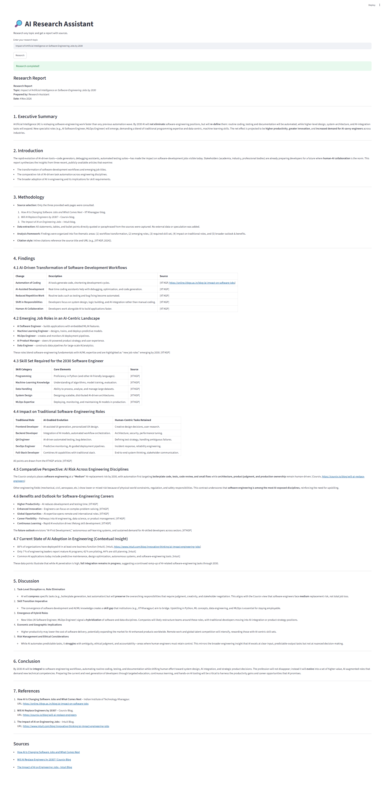
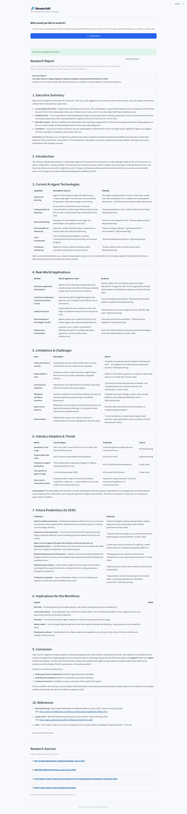
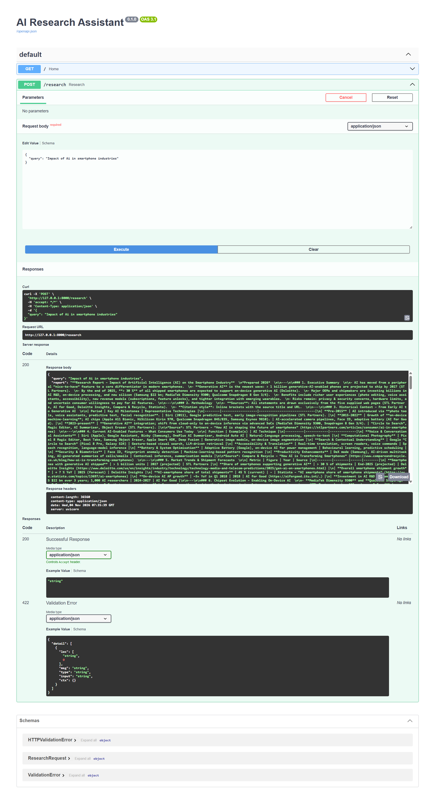

# 🔎 ResearchAI — Agentic Research Platform

An AI-powered research assistant that searches the web, extracts relevant information, and generates structured research reports using Large Language Models (LLMs).

Built with **Python, LangGraph, FastAPI, and Streamlit**, ResearchAI is designed to evolve into an extensible AI research platform with future support for RAG, document intelligence, memory, and additional AI tools.

---

## ✨ Features

- **AI-Powered Research** — Generate structured research reports from a user query.
- **Web Search** — Retrieve relevant information using Tavily.
- **Web Scraping** — Extract readable content from webpages using Trafilatura.
- **Agent Workflow** — Orchestrate the research pipeline using LangGraph.
- **Multiple LLM Providers** — Support for Groq, Google Gemini, and NVIDIA-compatible APIs.
- **REST API** — Expose research functionality through FastAPI.
- **Interactive UI** — Simple research interface built with Streamlit.
- **Source References** — Display the webpages used during research.
- **Report Export** — Download generated reports in Markdown format.

## 🖥️ Application Preview

### 1. ResearchAI — Frontend

The Streamlit interface allows users to submit research topics and view generated reports.



### 2. Generated Research Report

Structured reports with sections, tables, references, and source links.



### 3. FastAPI Backend

Interactive API documentation and research endpoint.



### 4. Sample Research Output

[📄 View Sample Research Report (PDF)](docs/assets/final_output.pdf)

---

## 🏗️ Architecture

```text
                 USER
                   |
                   v
            STREAMLIT FRONTEND
                   |
                   v
              FASTAPI
                   |
                   v
            LANGGRAPH AGENT
                   |
          +--------+--------+
          |        |        |
          v        v        v
       SEARCH   SCRAPER    LLM
       TAVILY  TRAFILATURA |
          |        |       |
          +--------+-------+
                   |
                   v
           RESEARCH REPORT
                   |
                   v
          FRONTEND + SOURCES
```

### Research Workflow

1. User submits a research query.
2. LangGraph starts the research workflow.
3. Tavily searches for relevant webpages.
4. Trafilatura extracts webpage content.
5. The selected LLM analyzes the collected information.
6. A structured research report is generated.
7. FastAPI returns the report and source information.
8. Streamlit displays the final result.

---

## 🛠️ Tech Stack

| Category | Technologies |
|---|---|
| Language | Python |
| Agent Workflow | LangGraph |
| LLM Integration | LangChain |
| LLM Providers | Groq, Gemini, NVIDIA |
| Web Search | Tavily |
| Web Scraping | Trafilatura |
| Backend | FastAPI |
| Frontend | Streamlit |
| Data Validation | Pydantic |
| Package Management | uv |
| Version Control | Git & GitHub |

---

## 📂 Project Structure

```text
researchAI/
│
├── frontend/
│   └── app.py
│
├── src/
│   ├── agent/
│   │   └── graph.py
│   │
│   ├── api/
│   │   └── api.py
│   │
│   ├── config/
│   │   └── settings.py
│   │
│   ├── llm/
│   │   └── providers.py
│   │
│   ├── tools/
│   │   ├── search.py
│   │   └── scraper.py
│   │
│   └── main.py
│
├── tests/
│
├── docs/
│   └── assets/
│       ├── fastapi.png
│       ├── streamlit1.png
│       ├── streamlit2.png
│       └── final_output.pdf
│
├── .env.example
├── .gitignore
├── .python-version
├── pyproject.toml
├── uv.lock
└── README.md
```

---

## ⚙️ Installation & Setup

### Prerequisites

- Python 3.13
- Git
- uv package manager
- API keys for your selected LLM provider
- Tavily API key

### 1. Clone the Repository

```bash
git clone https://github.com/akhileshr24/researchAi.git

cd researchAi
```

### 2. Install Dependencies

```bash
uv sync
```

### 3. Configure Environment Variables

Create a `.env` file in the project root.

Use `.env.example` as your reference.

Configure the API keys for your selected providers:

```env
GROQ_API_KEY=
GROQ_MODEL=openai/gpt-oss-120b

GEMINI_API_KEY=
GEMINI_MODEL=gemini-2.5-flash

NVIDIA_API_KEY=
NVIDIA_BASE_URL=https://integrate.api.nvidia.com/v1
NVIDIA_MODEL=nvidia/nemotron-3-ultra-550b-a55b

TAVILY_API_KEY=

PRIMARY_LLM=groq

LANGCHAIN_TRACING_V2=false
LANGSMITH_TRACING=false
```

**Security:** Never commit your `.env` file or expose API keys publicly.

### 4. Start the FastAPI Backend

Open the first terminal:

```bash
uv run uvicorn src.api.api:app --reload
```

Backend:

`http://localhost:8000`

API Documentation:

`http://localhost:8000/docs`

### 5. Start the Streamlit Frontend

Open another terminal:

```bash
uv run streamlit run frontend/app.py
```

Frontend:

`http://localhost:8501`

---

## 🔌 API Endpoints

| Method | Endpoint | Description |
|---|---|---|
| GET | `/` | Check API status |
| POST | `/research` | Generate a research report |
| GET | `/docs` | Interactive API documentation |

### Example Request

```json
{
  "query": "Impact of AI in software engineering"
}
```

### Example Response

```json
{
  "query": "Impact of AI in software engineering",
  "report": "Generated research report...",
  "sources": [
    {
      "title": "Research Source",
      "url": "https://example.com",
      "content": "Extracted webpage content..."
    }
  ]
}
```

---

## 🚀 Future Roadmap

ResearchAI is being developed incrementally, with a focus on expanding its research capabilities.

- [ ] Retrieval-Augmented Generation (RAG)
- [ ] PDF and document uploads
- [ ] Vector database integration
- [ ] Conversational memory
- [ ] Additional research tools
- [ ] Improved source verification and citation quality
- [ ] Research history and SQLite persistence
- [ ] Automated testing
- [ ] Docker support
- [ ] Cloud deployment

---

## 🎯 Project Goal

The goal of ResearchAI is to build a modular and extensible AI research platform that combines agentic workflows, web intelligence, LLMs, and document retrieval into one application.

The long-term vision is to develop a capable research assistant that can search, understand, analyze, and organize information from multiple sources.

---

## 👨‍💻 Author

**Akhilesh R**

- GitHub: [@akhileshr24](https://github.com/akhileshr24)
- Project: [ResearchAI](https://github.com/akhileshr24/researchAi)

---